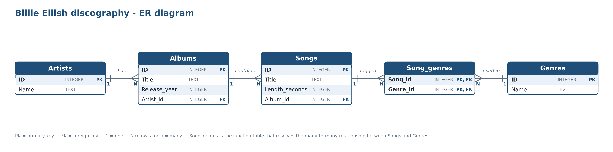

# SQL-inlämning — Diskografi

**Namn:** Oliver Ågren
**Artist:** Billie Eilish
**Datum:** 2026-10-14

---

> Lägg länk till eller bild på ditt ER-diagram här:
## ER-diagram



---

## 1. Skapa databasen — CREATE TABLE

```sql
CREATE TABLE IF NOT EXISTS "Artists" (
	"ID"	INTEGER,
	"Name"	TEXT,
	PRIMARY KEY("ID")
);
CREATE TABLE IF NOT EXISTS "Albums" (
	"ID"	INTEGER,
	"Title"	TEXT,
	"Release_year"	INTEGER,
	"Artist_id"	INTEGER,
	PRIMARY KEY("ID"),
	FOREIGN KEY("Artist_id") REFERENCES "Artists"("ID")
);
CREATE TABLE IF NOT EXISTS "Genres" (
	"ID"	INTEGER,
	"Name"	TEXT,
	PRIMARY KEY("ID")
);
CREATE TABLE IF NOT EXISTS "Songs" (
	"ID"	INTEGER,
	"Title"	TEXT,
	"Length_seconds"	INTEGER,
	"Album_id"	INTEGER,
	PRIMARY KEY("ID"),
	FOREIGN KEY("Album_id") REFERENCES "Albums"("ID")
);
CREATE TABLE IF NOT EXISTS "Song_genres" (
	"Song_id"	INTEGER,
	"Genre_id"	INTEGER,
	PRIMARY KEY("Song_id","Genre_id"),
	FOREIGN KEY("Genre_id") REFERENCES "Genres"("ID"),
	FOREIGN KEY("Song_id") REFERENCES "Songs"("ID")
);

```

---

## 2. Seeda med data — INSERT

```sql
INSERT INTO "Artists" VALUES (1,'Billie Eilish');
INSERT INTO "Albums" VALUES (1,'When We All Fall Asleep, Where Do We Go?',2019,1);
INSERT INTO "Albums" VALUES (2,'Happier Than Ever',2021,1);
INSERT INTO "Albums" VALUES (3,'Hit Me Hard And Soft',2024,1);
INSERT INTO "Genres" VALUES (1,'Pop');
INSERT INTO "Genres" VALUES (2,'Electropop');
INSERT INTO "Genres" VALUES (3,'Alternative pop');
INSERT INTO "Genres" VALUES (4,'Dance-pop');
INSERT INTO "Genres" VALUES (5,'Synth-pop');
INSERT INTO "Genres" VALUES (6,'Electronica');
INSERT INTO "Genres" VALUES (7,'Industrial pop');
INSERT INTO "Genres" VALUES (8,'Indie pop');
INSERT INTO "Genres" VALUES (9,'New wave');
INSERT INTO "Genres" VALUES (10,'Techno');
INSERT INTO "Genres" VALUES (11,'Folk');
INSERT INTO "Songs" VALUES (1,'Bad guy',194,1);
INSERT INTO "Songs" VALUES (2,'Bury a friend',193,1);
INSERT INTO "Songs" VALUES (3,'When the party''s over',196,1);
INSERT INTO "Songs" VALUES (4,'Happier than ever',298,2);
INSERT INTO "Songs" VALUES (5,'Your power',245,2);
INSERT INTO "Songs" VALUES (6,'Oxytocin',210,2);
INSERT INTO "Songs" VALUES (7,'CHIHIRO',303,3);
INSERT INTO "Songs" VALUES (8,'BIRDS OF A FEATHER',210,3);
INSERT INTO "Songs" VALUES (9,'LUNCH',179,3);
INSERT INTO "Songs" VALUES (10,'THE DINER',186,3);
INSERT INTO "Song_genres" VALUES (1,1);
INSERT INTO "Song_genres" VALUES (1,4);
INSERT INTO "Song_genres" VALUES (1,2);
INSERT INTO "Song_genres" VALUES (2,5);
INSERT INTO "Song_genres" VALUES (2,6);
INSERT INTO "Song_genres" VALUES (2,2);
INSERT INTO "Song_genres" VALUES (3,1);
INSERT INTO "Song_genres" VALUES (4,1);
INSERT INTO "Song_genres" VALUES (5,11);
INSERT INTO "Song_genres" VALUES (6,10);
INSERT INTO "Song_genres" VALUES (6,7);
INSERT INTO "Song_genres" VALUES (6,2);
INSERT INTO "Song_genres" VALUES (7,9);
INSERT INTO "Song_genres" VALUES (7,6);
INSERT INTO "Song_genres" VALUES (8,8);
INSERT INTO "Song_genres" VALUES (8,9);
INSERT INTO "Song_genres" VALUES (9,2);
INSERT INTO "Song_genres" VALUES (9,1);
INSERT INTO "Song_genres" VALUES (10,3);

```

---

## 3. Söka — SELECT

```sql
--- query 1: Lista alla album, sorterade efter år --- 
SELECT Title, Release_year 
FROM Albums 
ORDER BY Release_year;


--- query 2: Lista alla låtar på ett specifikt album ---
SELECT Songs.Title
FROM Songs
JOIN Albums ON Songs.Album_id = Albums.ID
WHERE Albums.Title = 'Happier Than Ever';

--- query 3: Antal låtar per album ---
SELECT Albums.Title, COUNT(Songs.ID) AS Antal_latar
FROM Albums
JOIN Songs ON Songs.Album_id = Albums.ID
GROUP BY Albums.ID
ORDER BY Antal_latar DESC;

--- query 4: Längsta låten ---
SELECT Title, Length_seconds 
FROM Songs 
ORDER BY Length_seconds 
DESC LIMIT 1;


--- query 5: Alla låtar sorterade alfabetiskt ---
SELECT Title FROM Songs ORDER BY Title COLLATE NOCASE;
```

---

## 4. Lägg till en ny rad — INSERT

```sql
INSERT INTO Songs (ID, Title, Length_seconds, Album_id)
VALUES (12, 'Testtesttest', 200, 3);

INSERT INTO Songs (ID, Title, Length_seconds, Album_id)
VALUES (11, 'Testtesttest', 200, 3);

```

---

## 5. Ta bort en rad — DELETE

```sql
DELETE FROM Songs
WHERE ID = 12;

```

---

## 6. Uppdatera en rad — UPDATE

```sql
UPDATE Songs
SET Length_seconds = 215
WHERE ID = 11;


```

---

## 7. VG-queries (om du siktar på VG)

```sql
--- query 6: Snittlängd på låtar per album ---
SELECT Albums.Title, AVG(Songs.Length_seconds) AS Snittlangd
FROM Albums
JOIN Songs ON Songs.Album_id = Albums.ID
GROUP BY Albums.ID;


--- query 7: Albumet med flest låtar ---
SELECT Albums.Title, COUNT(Songs.ID) AS Antal
FROM Albums
JOIN Songs ON Songs.Album_id = Albums.ID
GROUP BY Albums.ID
ORDER BY Antal DESC
LIMIT 1;

--- query 8: Alla låtar längre än 4 minuter (240 sekunder), med albumtitel ---
SELECT Songs.Title, Songs.Length_seconds, Albums.Title AS Album
FROM Songs
JOIN Albums ON Songs.Album_id = Albums.ID
WHERE Songs.Length_seconds > 240;

```
